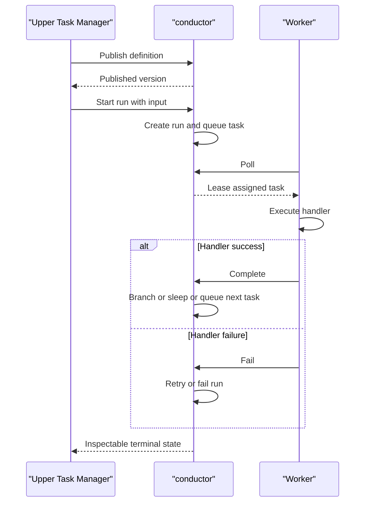

# conductor Interface Contract Design

## Goal

Define the intended interface contract between:

- the upper `task manager`
- `conductor`
- workers

This document describes the boundary contract, not the internal storage design.

## Design Principle

The contract should preserve one clear separation:

- the upper task manager owns business meaning and orchestration decisions
- `conductor` owns durable execution mechanics
- workers own code execution for registered handlers

If an interface forces one layer to understand another layer's internal concern, the contract is wrong.

## Actors

### Upper Task Manager

Owns:

- business objects
- product state transitions
- decision to start an automation
- interpretation of final run result
- ownership of all async external callbacks and human interactions

Needs from `conductor`:

- definition publish
- run start
- run inspection
- step and transition inspection

Must not need to know:

- lease tokens
- worker polling rules
- retry timer internals
- recovery scan details

### conductor

Owns:

- published workflow definitions
- durable runs and step instances
- queueing and lease rules
- timeout, retry, sleep, recovery
- routing decisions derived from definition and worker manifest defaults

Needs from the upper task manager:

- a stable workflow id or version target
- run input
- optional operational inspection requests

Needs from workers:

- handler registrations
- polling identity
- task execution result

### Worker

Owns:

- executable handlers
- handler metadata defaults
- task execution
- lease heartbeats

Needs from `conductor`:

- poll response with task assignment
- fencing and attempt identity
- completion and failure mutation endpoints

Must not need to know:

- business object semantics
- why the run was started
- upstream product orchestration state

## Contract Surfaces

## 1. Definition Contract

The upper task manager publishes a workflow definition to `conductor`.

The definition contract expresses:

- workflow identity
- immutable published version
- `task`, `sleep`, and `branch`
- task routing hints:
  - `handler`
  - `capability`
  - `queue`
  - `timeout_seconds`

The definition contract must not express:

- callback wait
- human approval
- external async signal resume
- business object ownership

### Definition responsibilities by side

Upper task manager:

- chooses workflow shape
- chooses step ids and data flow
- decides whether a use case belongs in `conductor`

`conductor`:

- validates structural correctness
- validates handler compatibility against registry metadata
- stores immutable published versions

Worker:

- exposes handler defaults that definitions may reference or override

## 2. Run Start Contract

The upper task manager starts a run when it has enough input to execute a self-contained automation.

Run start must carry:

- workflow id
- optionally workflow version if explicit pinning is desired
- run input payload

Run start must not imply:

- subscription to future callbacks
- ownership transfer of a business object
- automatic resume from future external signals

### Run start rule

If completion of the use case depends on a future external event, the upper task manager should not model that as a single `conductor` run.

## 3. Task Dispatch Contract

`conductor` converts a runnable `task` step into queueable work.

Routing is determined by:

1. explicit step metadata
2. worker registry defaults when omitted

Publication snapshots the resulting capability, queue, timeout, and routing inputs. Runtime execution never re-resolves an existing published version from live registry defaults.

This contract guarantees:

- deterministic queue selection
- deterministic capability selection
- explicit task timeout semantics

This contract intentionally hides:

- internal task table representation
- recovery bookkeeping
- lease storage model

## 4. Worker Poll Contract

Workers interact through a pull protocol.

The worker-facing operations are:

- `poll`
- `heartbeat`
- `complete`
- `fail`

The contract guarantees:

- a worker only receives work it is eligible to run
- leased work has a durable attempt identity
- stale completions are rejected
- timeout and recovery are enforced by the engine

The worker does not own orchestration. It only owns task execution.

## 5. Sleep Contract

`sleep` is a durable timer contract between the upper task manager and `conductor`.

Meaning:

- the upper task manager may model "run this next step later"
- `conductor` is responsible for preserving that delay durably
- workers do not sleep in memory waiting for the next step

This contract exists specifically so the upper task manager can delegate delayed synchronous automation without building its own timer orchestration.

## 6. Branch Contract

`branch` is an internal execution contract.

Meaning:

- branch decisions are made from currently available run input or prior step output
- branch does not wait for external information
- branch only decides the next internal execution path

This keeps branching inside `conductor` while keeping external orchestration outside it.

## 7. Completion Contract

When a run reaches terminal state, `conductor` exposes:

- run status
- step instances
- transitions
- final step outputs and errors as recorded state

The upper task manager then decides:

- which business state to change
- whether to notify a user
- whether to launch a different automation

`conductor` must not make those business decisions.

## 8. Failure Contract

Failure semantics should be split clearly.

`conductor` owns:

- task failure persistence
- retry scheduling
- timeout classification
- lease recovery
- terminal run failure state

The upper task manager owns:

- business interpretation of failure
- user-facing consequences
- compensating business actions
- any decision to start a different workflow afterward

Workers own:

- accurate success or failure reporting
- structured failure payloads when possible

## 9. Inspection Contract

The upper task manager and operators need read access to execution state.

The stable inspection surface should center on:

- latest published definition
- published versions
- run record
- step instances
- transition log

The inspection contract should answer:

- what definition version was used
- what step is currently running or failed
- what transition happened last
- what task routing and timeout rules applied

It should not require callers to understand storage internals.

## 10. Non-Contracts

The following should remain outside this interface boundary:

- callback registration and resume protocol
- event waiter inspection
- human approval assignment
- product authorization semantics
- cross-product business event routing

If any of those start leaking into the upper task manager to `conductor` contract, the system boundary has widened too far.

## Contract Summary

The intended interaction model is:

1. the upper task manager publishes a sync-only workflow
2. the upper task manager starts a run with current input
3. `conductor` schedules and durably executes `task`, `sleep`, and `branch`
4. workers pull and execute handlers
5. `conductor` reports terminal execution state
6. the upper task manager resumes ownership of business meaning

## Sequence Diagram

