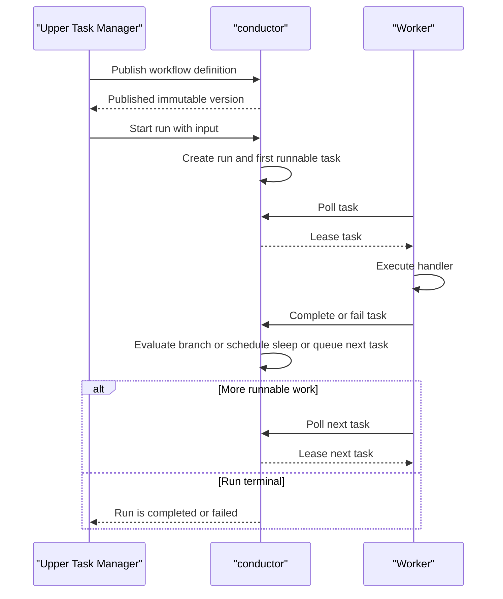
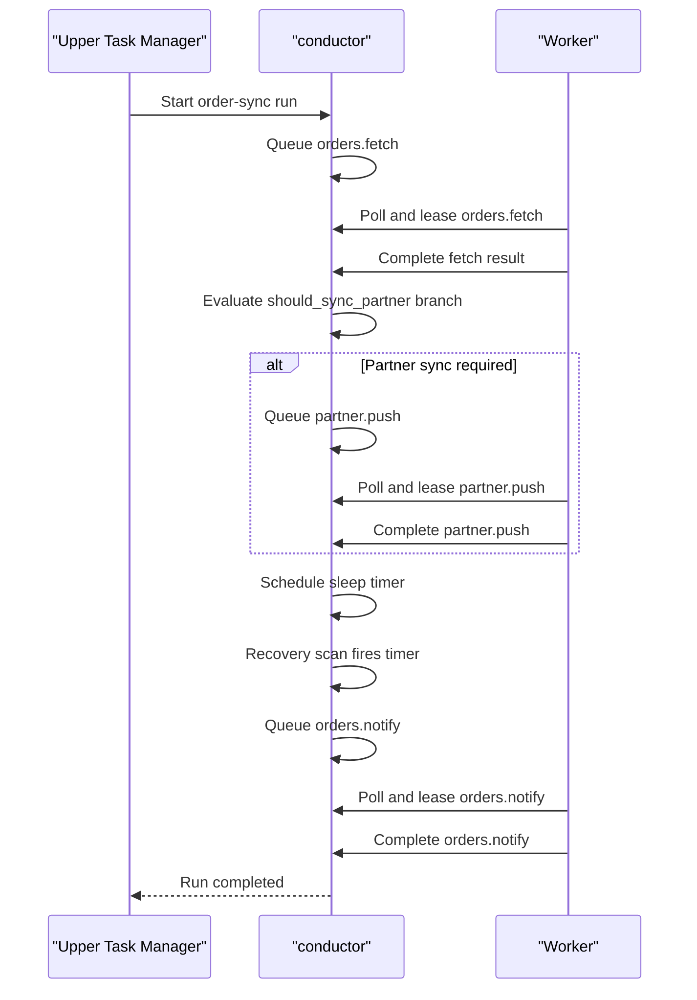
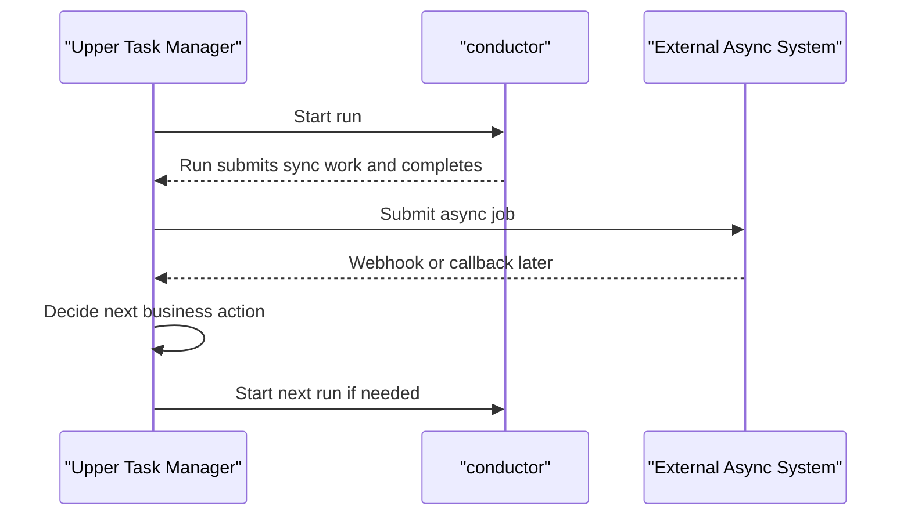

# conductor User Scenarios Design

## Goal

Define the primary user scenarios for `conductor` after narrowing its responsibility to synchronous, self-contained automation execution under a higher-level task manager.

This document is not a product workflow spec for the whole system. It is a usage design for when and how the upper task manager should delegate work to `conductor`.

## Primary User

The primary user is the developer of the higher-level `task manager`.

This user is responsible for:

- deciding when an automation should run
- deciding which business object or business state requires that automation
- interpreting the final result and updating product state

This user is not using `conductor` as a full orchestration product. They are using it as a durable execution engine.

Secondary users exist, but are not the design center:

- worker or handler developers
- operators or SREs

## Core Product Statement

`conductor` is a durable engine for self-contained synchronous automation runs.

The upper task manager delegates a bounded execution problem to `conductor` when:

- the automation can complete from the currently available input
- all external interactions are synchronous at the step boundary
- delayed continuation can be modeled as `sleep`
- the run can eventually end as `completed` or `failed` without waiting for an external callback or human action

## Responsibility Boundary

`conductor` is responsible for:

- workflow definition storage, validation, and publish
- durable run creation
- task lease, heartbeat, completion, failure, retry, timeout, and recovery
- synchronous code execution
- synchronous external API or system calls performed inside task handlers
- durable delayed continuation through `sleep`
- internal branching through `branch`
- run, step, and transition inspection

`conductor` is not responsible for:

- webhook or callback correlation
- waiting for external async completion
- human approval or inbox semantics
- product business state ownership
- deciding whether a later external event should advance the business process

Those concerns remain in the upper task manager.

## Workflow Shape

The supported workflow shape is intentionally small:

- `task`
- `sleep`
- `branch`

This means the user scenario is also intentionally small:

- start from known input
- execute one or more tasks
- optionally delay
- optionally branch
- finish

If a workflow must pause until a later external signal arrives, that is not a `conductor` scenario. The upper task manager must observe that async event and decide whether to start a new `conductor` run or invoke a different workflow.

## Common Lifecycle Scenario

This is the baseline scenario that all domain examples follow.

### 1. Handler authoring

A worker developer implements handlers and registers them in the worker registry.

Each handler exposes an execution contract:

- `handler`
- `capability`
- `queue`
- `timeout_seconds`

This is the manifest-like default surface that `conductor` validates against and uses during queueing.

### 2. Workflow authoring and publish

The upper task manager developer defines a workflow using `task`, `sleep`, and `branch`.

They publish it through `conductor`.

At publish time, `conductor` verifies:

- the referenced handlers exist
- explicit step routing metadata is compatible with the handler registration
- timeout values are in a supported range
- the workflow shape is structurally valid

The result is an immutable published workflow version.

### 3. Run start

The upper task manager decides that a specific automation should run for a specific business reason.

It starts a `conductor` run with input data.

`conductor` does not know the business meaning of the run. It only knows:

- which published definition to use
- which input payload to execute against

### 4. Task scheduling

`conductor` creates the first runnable task.

Queueing uses:

- explicit per-step metadata when provided
- effective routing metadata snapshotted at publication after handler registry defaults fill omitted values

This gives the upper task manager developer predictable routing without embedding worker topology into product code.

### 5. Worker execution

Workers execute tasks using the pull contract:

- poll
- lease
- execute
- complete or fail

If a step completes successfully:

- the engine evaluates outgoing edges
- `branch` selects the next path
- `sleep` schedules a durable timer
- downstream `task` steps become runnable

### 6. Run completion

When the workflow reaches a terminal state, `conductor` records the final result.

The upper task manager reads the final run state and decides what to do with it in product terms.

## Sequence Diagrams

These diagrams show the intended user journey at the system boundary level.

### Common Lifecycle

### Order Sync

### Non-Fit Async Boundary

## Domain Scenario A: Order Sync

### User intent

The upper task manager wants to perform a bounded order-processing automation after an order is created.

### Why it fits `conductor`

- all step boundaries are synchronous
- any delay can be modeled as `sleep`
- the run ends without waiting for an external callback

### Flow

1. The upper task manager observes that a new order should be processed.
2. It starts a `conductor` run with order input.
3. `task: orders.fetch`
   - fetches order details
   - may call synchronous internal or external APIs
4. `branch: should_sync_partner`
   - checks whether partner sync is needed from current data
5. `task: partner.push`
   - only on the true branch
6. `sleep: 30s`
   - absorbs short propagation delay or rate-limit pressure
7. `task: orders.notify`
   - sends final synchronous notification
8. The run completes and the upper task manager updates order state

### Non-fit variant

If `partner.push` creates an async job and a webhook later confirms completion, that is not a single `conductor` scenario. The upper task manager must own the webhook and decide what to run next.

## Domain Scenario B: Document Generation

### User intent

The upper task manager wants to generate a document from current data and store the final artifact.

### Why it fits `conductor`

- document generation is a bounded execution problem
- retries and timeouts are useful
- post-processing can stay synchronous

### Flow

1. The upper task manager decides a document must be generated.
2. It starts a `conductor` run.
3. `task: documents.collect_input`
   - loads required source data
4. `branch: has_required_fields`
   - validates whether generation can proceed
5. `task: documents.render`
   - synchronously renders the document
6. `branch: needs_postprocess`
7. `task: documents.postprocess`
   - optional cleanup, watermarking, or transformation
8. `task: documents.store`
   - stores the final artifact synchronously
9. The run completes and the upper task manager records the document reference

### Non-fit variant

If rendering is delegated to an external async service that returns later, `conductor` should not hold the wait. The upper task manager must manage that asynchronous boundary.

## Domain Scenario C: Synchronous API Orchestration

### User intent

The upper task manager wants to call several internal or external systems in a strict, durable sequence.

### Why it fits `conductor`

- the flow is code-heavy but not product-state-heavy
- every system call returns synchronously
- retries, timeouts, and crash recovery matter more than broad orchestration semantics

### Flow

1. The upper task manager starts a run for a specific business action.
2. `task: crm.lookup`
3. `branch: customer_exists`
4. `task: crm.create`
   - only when needed
5. `task: billing.prepare_invoice`
6. `sleep: 10s`
   - allows short stabilization before the next call
7. `task: erp.push_invoice`
8. The run completes and the upper task manager consumes the result

### Design value

This keeps the business system simple:

- the upper task manager owns meaning
- `conductor` owns durable execution mechanics

## Failure Scenarios

The primary user cares about failure semantics because they are delegating durable execution to `conductor`.

### Task failure

If a handler returns failure:

- `conductor` records the failure
- it either schedules a retry or fails the run
- the upper task manager consumes only the final result unless it wants deeper inspection

### Worker crash

If a worker crashes after leasing a task:

- the lease expires
- recovery requeues the task
- the run continues without the upper task manager implementing its own repair logic

### Task timeout

If a handler exceeds its task timeout:

- `conductor` marks the task as timed out
- retry or terminal failure is applied through the engine's own rules

### Process restart during `sleep`

If the engine restarts while a run is sleeping:

- the timer remains durable
- recovery resumes the run later

### Invalid workflow authoring

If the workflow references a missing or incompatible handler:

- publish fails
- the bad workflow does not enter the runnable surface

## Operational Scenarios

These are not the primary authoring scenarios, but they matter for real use.

### Investigating a stuck or slow run

The operator or developer inspects:

- run status
- step instances
- transition log
- current task routing and timeout behavior

### Rolling out a new definition version

The upper task manager publishes a new workflow version.

Expected behavior:

- new runs use the latest published version eligible under the current DSL and routing-snapshot contract
- existing runs stay pinned to the version they started with
- retained unsupported versions remain inspectable but cannot start new runs; pre-snapshot versions require explicit republish

This is critical for safe product rollout.

### Investigating worker capacity mismatch

The operator observes that tasks are not being picked up as expected.

The likely root causes are:

- wrong queue
- wrong capability
- insufficient workers for a routing target

This scenario is why explicit task routing metadata matters.

## Non-Scenarios

The following are explicitly not valid `conductor` user scenarios under the current boundary:

- "Start a job and wait for a webhook before resuming"
- "Pause for human approval and continue later"
- "Model the full product state machine inside the workflow engine"
- "Let the engine decide business ownership transitions"
- "Use `conductor` as a general async integration bus"

In all of those cases, the upper task manager remains the orchestration owner.

## Acceptance Criteria For Correct Use

A use case is a good fit for `conductor` when the upper task manager developer can say all of the following:

- the run starts from currently available input
- each step either completes synchronously, fails, or sleeps
- no step depends on a future external callback to become complete
- the final run result is enough for the upper task manager to continue business processing
- retries, timeout handling, and crash recovery should be delegated to the engine

If those conditions are not true, the use case should stay above `conductor`.

## Summary

The correct user scenario for `conductor` is not "build the whole workflow product here".

The correct user scenario is:

- the upper task manager delegates a self-contained synchronous automation run
- `conductor` executes it durably with routing, lease, retry, timeout, sleep, branch, and recovery
- the upper task manager owns every business or asynchronous orchestration concern outside that boundary
