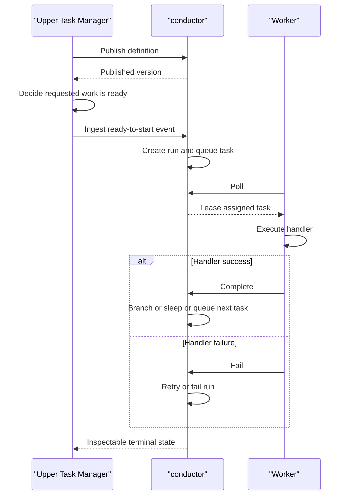

# conductor Interface Contract

## Goal

Define the intended interface contract between:

- the upper `task manager`
- `conductor`
- workers

This document defines the boundary contract, not the internal storage design.

## Design Principle

The contract preserves one clear split:

- the upper task manager owns business meaning and orchestration decisions
- `conductor` owns durable execution mechanics
- workers own code execution for registered handlers

## Actors

### Upper Task Manager

Owns:

- business objects
- product state transitions
- the decision to start an automation
- interpretation of final run result
- ownership of async external callbacks and human interactions

Needs from `conductor`:

- definition publish
- run start
- run inspection
- step and transition inspection

Must not need to know:

- lease tokens
- worker polling rules
- retry timer internals
- recovery scan details

### conductor

Owns:

- published workflow definitions
- durable runs and step instances
- queueing and lease rules
- timeout, retry, sleep, and recovery
- routing decisions derived from definition and worker manifest defaults

Needs from the upper task manager:

- workflow id or version target
- run input
- optional inspection requests

Needs from workers:

- handler registrations
- polling identity
- task execution result

### Worker

Owns:

- executable handlers
- handler metadata defaults
- task execution
- lease heartbeats

Needs from `conductor`:

- task assignment
- fencing and attempt identity
- completion and failure mutation surfaces

Must not need to know:

- business object semantics
- why the run was started
- upstream product orchestration state

## Contract Surfaces

### 1. Definition Contract

The upper task manager publishes a workflow definition to `conductor`.

The definition contract expresses:

- workflow identity
- immutable published version
- `task`, `sleep`, and `branch`
- task routing hints:
  - `handler`
  - `capability`
  - `queue`
  - `timeout_seconds`

The definition contract must not express:

- callback wait
- human approval
- external async signal resume
- business object ownership

Responsibilities:

- upper task manager chooses workflow shape and data flow
- `conductor` validates structure and handler compatibility
- workers expose handler defaults that definitions may inherit at publication time

### Definition Version And Compatibility Contract

The confirmed target contract for the `0.2.0` remediation is:

- the proposed `wait_for_event` and `emit_event` authoring APIs were removed before release and have no compatibility runtime
- published versions remain immutable and inspectable; stored definitions are never silently reinterpreted
- stored JSON that does not match the current authoring schema remains available as a raw diagnostic record but is not executable
- no new publication or new run may select an unsupported definition
- versions published before effective routing metadata was snapshotted remain inspectable but non-executable and ineligible for new runs until explicitly republished as a new version
- destructive removal is blocked while active runs reference a published version

Eligibility for new runs is therefore distinct from retention and inspection. Keeping an old published version does not make it eligible for new execution.

In `0.2.0`, this retention rule intentionally changes the published-definition inspection response. `GET /v1/workflows/{workflow_id}/versions`, exact version GETs, and `latest_published` in `GET /v1/workflows/{workflow_id}` return a lossless inspection record rather than the old parsed `definition` object. The record carries the retained row's signed 64-bit `workflow_version`, raw `definition_json`, raw nullable `execution_metadata_json`, hashes and timestamps, classification, execution compatibility, `new_run_eligible`, and an optional typed decode diagnostic. This is a breaking wire-shape change: malformed or unsupported JSON remains visible as text, while executable and run-pinned workflow versions remain `u32`.

The `0.2.0` history-list contract is also deliberately bounded. `GET /v1/workflows/{workflow_id}/versions` accepts `limit` and the exclusive signed-64-bit keyset `after_version`. `limit` defaults to 100 and may be 1 through 100; omission now returns the first 100 versions in ascending numeric order rather than an unbounded history. To continue, a client sends the last returned `workflow_version` as `after_version`. This preserves negative, above-`u32`, malformed, and otherwise diagnostic retained rows. Exact version GET behavior is unchanged.

Run step history uses the exclusive composite keyset `(after_created_at, after_step_instance_id)` and transition history uses `(after_created_at, after_transition_id)`. Both routes order by `(created_at, stable_id)`, default to 100 records, and accept limits from 1 through 100. Both cursor components must be omitted together or supplied together; clients continue with the timestamp and stable identifier of the last returned record. Malformed values, `limit=0`, `limit>100`, and half-cursors return `400 Bad Request`; limits are never silently clamped.

These rules are policy and implementation targets. They are not considered verified until the persistence, runtime, API, migration, and recovery tests record matching evidence.

### 2. Request vs Ready Contract

The upper task manager must distinguish:

- a request for work
- a decision that the work is ready for `conductor`

Examples:

- `document_generation_requested` is a business event
- `document_generation_ready` is a valid `conductor` start event

`conductor` should not decide whether requested work is ready to begin. That readiness decision belongs to the upper task manager.

### 3. Run Start Contract

The normal start path is event ingest of a ready-to-start event when the upper task manager has enough input to execute a self-contained automation.

Start input must carry:

- workflow id
- an event or payload that represents readiness for execution
- run input payload

Start input must not imply:

- subscription to future callbacks
- ownership transfer of a business object
- automatic resume from future external signals

Rule:

- if completion depends on a future external event, the upper task manager should not model that as a single `conductor` run
- if the upper task manager cannot yet say the work is ready, `conductor` should not be started

An imperative direct-start API may still exist for testing, replay, or operator actions, but it should be treated as a secondary path, not the primary product boundary.

### 4. Task Dispatch Contract

`conductor` converts a runnable `task` step into queueable work.

At publication, routing is resolved from:

1. explicit step metadata
2. worker registry defaults when omitted

The resulting capability, queue, timeout, and other routing inputs are snapshotted into the immutable published version. Runtime dispatch reads that snapshot; it does not consult live defaults to reinterpret an existing published version or run. A registry-default change affects only a later publication.

This contract guarantees:

- deterministic queue selection
- deterministic capability selection
- explicit task timeout semantics

### 5. Worker Poll Contract

Workers interact through a pull protocol:

- `poll`
- `heartbeat`
- `complete`
- `fail`

The contract guarantees:

- a worker only receives work it is eligible to run
- leased work has a durable attempt identity
- stale completions are rejected
- timeout and recovery are enforced by the engine

### 6. Sleep Contract

`sleep` is a durable timer contract between the upper task manager and `conductor`.

Meaning:

- the upper task manager may model "run this next step later"
- `conductor` preserves that delay durably
- workers do not sleep in memory waiting for the next step

### 7. Branch Contract

`branch` is an internal execution contract.

Meaning:

- branch decisions are made from currently available run input or prior step output
- branch does not wait for external information
- branch only decides the next internal execution path

### 8. Completion Contract

When a run reaches terminal state, `conductor` exposes:

- run status
- step instances
- transitions
- final outputs and errors as recorded state

The upper task manager then decides:

- which business state to change
- whether to notify a user
- whether to launch a different automation

### 9. Failure Contract

`conductor` owns:

- task failure persistence
- retry scheduling
- timeout classification
- lease recovery
- terminal run failure state

The upper task manager owns:

- business interpretation of failure
- user-facing consequences
- compensating business actions
- any decision to start a different workflow afterward

Workers own:

- accurate success or failure reporting
- structured failure payloads when possible

### 10. Inspection Contract

The stable inspection surface should center on:

- latest published definition
- published versions
- run record
- step instances
- transition log

It should answer:

- what definition version was used
- what step is currently running or failed
- what transition happened last
- what routing and timeout rules applied

### 11. Non-Contracts

The following stay outside this boundary:

- callback registration and resume protocol
- event waiter inspection
- human approval assignment
- product authorization semantics
- cross-product business event routing

## Sequence Diagram

## Summary

The intended interaction model is:

1. the upper task manager publishes a sync-only workflow
2. the upper task manager decides requested work is ready
3. the upper task manager ingests a ready-to-start event
4. `conductor` durably executes `task`, `sleep`, and `branch`
5. workers pull and execute handlers
6. `conductor` reports terminal execution state
7. the upper task manager resumes ownership of business meaning
