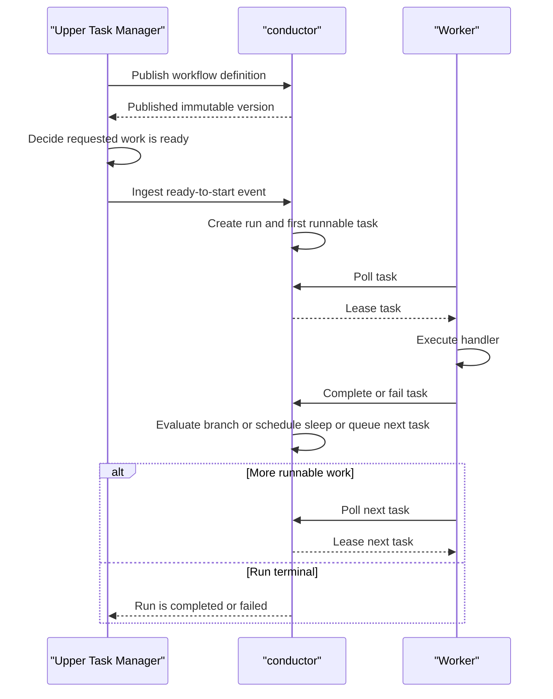
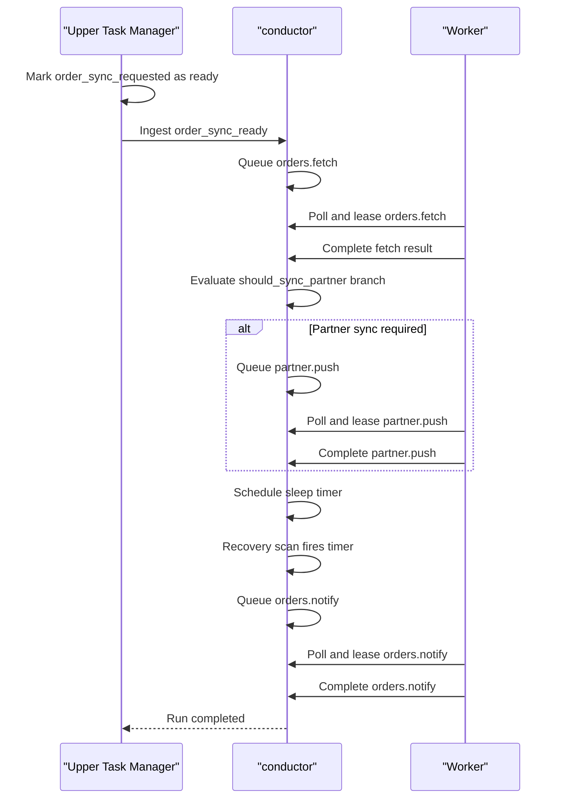
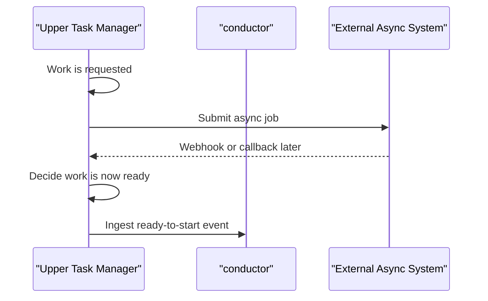

# conductor User Scenarios

## Goal

Define the primary user scenarios for `conductor` after narrowing its responsibility to synchronous, self-contained automation execution under a higher-level task manager.

This is a product-boundary spec. It explains when the upper task manager should delegate work to `conductor` and when it should not.

## Primary User

The primary user is the developer of the higher-level `task manager`.

This user is responsible for:

- deciding when an automation should run
- deciding which business object or business state requires that automation
- interpreting the final result and updating product state

This user is not using `conductor` as a full orchestration product. They are using it as a durable execution engine.

Secondary users exist, but are not the design center:

- worker or handler developers
- operators or SREs

## Core Product Statement

`conductor` is a durable engine for self-contained synchronous automation runs.

The upper task manager delegates a bounded execution problem to `conductor` when:

- the automation can complete from the currently available input
- all external interactions are synchronous at the step boundary
- delayed continuation can be modeled as `sleep`
- the run can eventually end as `completed` or `failed` without waiting for an external callback or human action

The key distinction is:

- a business-level request for work is not the same thing as a `conductor` run start
- the upper task manager decides when requested work has become ready for self-contained synchronous execution
- `conductor` should usually start from a ready-to-start event, not from a generic imperative "begin now" command

## Responsibility Boundary

`conductor` is responsible for:

- workflow definition storage, validation, and publish
- durable run creation
- task lease, heartbeat, completion, failure, retry, timeout, and recovery
- synchronous code execution
- synchronous external API or system calls performed inside task handlers
- durable delayed continuation through `sleep`
- internal branching through `branch`
- run, step, and transition inspection

`conductor` is not responsible for:

- webhook or callback correlation
- waiting for external async completion
- human approval or inbox semantics
- product business state ownership
- deciding whether a later external event should advance the business process

Those concerns remain in the upper task manager.

## Workflow Shape

The supported workflow shape is intentionally small:

- `task`
- `sleep`
- `branch`

If a workflow must pause until a later external signal arrives, that is not a `conductor` scenario. The upper task manager must observe that async event and decide whether to start a new `conductor` run or invoke a different workflow.

## Common Lifecycle Scenario

### 1. Handler authoring

A worker developer implements handlers and registers them in the worker registry.

Each handler exposes an execution contract:

- `handler`
- `capability`
- `queue`
- `timeout_seconds`

### 2. Workflow authoring and publish

The upper task manager developer defines a workflow using `task`, `sleep`, and `branch`.

At publish time, `conductor` verifies:

- the referenced handlers exist
- explicit step routing metadata is compatible with the handler registration
- timeout values are in a supported range
- the workflow shape is structurally valid

The result is an immutable published workflow version.

### 3. Request and readiness

The upper task manager should distinguish:

- work requested
- work ready to start in `conductor`

Typical lifecycle:

- `order_sync_requested`
- prerequisites checked
- dedupe and ownership checked
- `order_sync_ready`

Only the `ready` state belongs at the `conductor` input boundary.

### 4. Run start

The upper task manager normally starts `conductor` by ingesting a ready-to-start event.

Typical examples:

- `order_sync_ready`
- `document_generation_ready`
- `invoice_push_ready`

`conductor` does not know the business meaning of the run. It only knows:

- which published definition to use
- which input payload to execute against

### 5. Task scheduling

`conductor` creates the first runnable task.

Queueing uses:

- explicit per-step metadata when provided
- effective routing metadata snapshotted at publication after handler registry defaults fill omitted values

Changing live handler defaults does not reroute an existing published version or a run already pinned to it.

### 6. Worker execution

Workers execute tasks using the pull contract:

- poll
- lease
- execute
- complete or fail

If a step completes successfully:

- the engine evaluates outgoing edges
- `branch` selects the next path
- `sleep` schedules a durable timer
- downstream `task` steps become runnable

### 7. Run completion

When the workflow reaches a terminal state, `conductor` records the final result.

The upper task manager reads the final run state and decides what to do with it in product terms.

## Sequence Diagrams

### Common Lifecycle

### Order Sync

### Non-Fit Async Boundary

## Domain Scenario A: Order Sync

Why it fits `conductor`:

- all step boundaries are synchronous
- any delay can be modeled as `sleep`
- the run ends without waiting for an external callback

Flow:

1. The upper task manager observes that order sync was requested.
2. It decides the work is ready for self-contained execution.
3. It ingests `order_sync_ready` into `conductor`.
4. `task: orders.fetch`
5. `branch: should_sync_partner`
6. `task: partner.push` on the true branch
7. `sleep: 30s`
8. `task: orders.notify`
9. The run completes and the upper task manager updates order state

Non-fit variant:

- if `partner.push` starts an async job and completion arrives later by webhook, the upper task manager must own that async boundary

## Domain Scenario B: Document Generation

Why it fits `conductor`:

- document generation is a bounded execution problem
- retries and timeouts are useful
- post-processing can stay synchronous

Flow:

1. The upper task manager receives a document-generation request.
2. It decides the data is complete and emits `document_generation_ready`.
3. `task: documents.collect_input`
4. `branch: has_required_fields`
5. `task: documents.render`
6. `branch: needs_postprocess`
7. `task: documents.postprocess`
8. `task: documents.store`
9. The run completes and the upper task manager records the document reference

Non-fit variant:

- if rendering depends on a later external completion callback, that stays above `conductor`

## Domain Scenario C: Synchronous API Orchestration

Why it fits `conductor`:

- the flow is code-heavy but not product-state-heavy
- every system call returns synchronously
- retries, timeouts, and crash recovery matter more than broad orchestration semantics

Flow:

1. The upper task manager receives a business action request.
2. It decides the action is ready to execute and emits a ready event.
3. `task: crm.lookup`
4. `branch: customer_exists`
5. `task: crm.create` when needed
6. `task: billing.prepare_invoice`
7. `sleep: 10s`
8. `task: erp.push_invoice`
9. The run completes and the upper task manager consumes the result

## Failure Scenarios

### Task failure

- `conductor` records the failure
- it either schedules a retry or fails the run
- the upper task manager consumes the final result unless it wants deeper inspection

### Worker crash

- the lease expires
- recovery requeues the task
- the upper task manager does not need custom repair logic

### Task timeout

- `conductor` marks the task as timed out
- retry or terminal failure is applied through engine rules

### Process restart during `sleep`

- the timer remains durable
- recovery resumes the run later

### Invalid workflow authoring

- publish fails before the bad workflow becomes runnable

## Operational Scenarios

### Investigating a stuck or slow run

Inspect:

- run status
- step instances
- transition log
- current routing and timeout behavior

### Rolling out a new definition version

Expected behavior:

- new runs use the latest published version that is eligible under the current DSL and routing-snapshot contract
- existing runs stay pinned to the version they started with
- retained unsupported versions stay inspectable, while unsupported or pre-snapshot versions cannot start new runs until an eligible replacement is explicitly published

### Investigating worker capacity mismatch

Common causes:

- wrong queue
- wrong capability
- insufficient workers for the routing target

## Non-Scenarios

The following are explicitly not valid `conductor` user scenarios:

- start a job and wait for a webhook before resuming
- pause for human approval and continue later
- model the full product state machine inside the workflow engine
- let the engine decide business ownership transitions
- use `conductor` as a general async integration bus

## Acceptance Criteria For Correct Use

A use case is a good fit for `conductor` when all of the following are true:

- the run starts from currently available input
- the upper task manager can define a clear `requested` to `ready` transition before `conductor` is involved
- each step either completes synchronously, fails, or sleeps
- no step depends on a future external callback to become complete
- the final run result is enough for the upper task manager to continue business processing
- retries, timeout handling, and crash recovery should be delegated to the engine

## Summary

The correct user scenario is:

- the upper task manager delegates a self-contained synchronous automation run
- the normal start path is a ready-to-start event, not a generic imperative start command
- `conductor` executes it durably with routing, lease, retry, timeout, sleep, branch, and recovery
- the upper task manager owns every business or asynchronous orchestration concern outside that boundary
